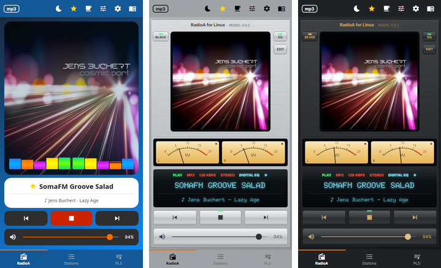

# RadioA for Linux

Internet radio for Linux, packaged for Debian-based systems. Your own station list, a 10-band equalizer, the
song that is playing with its album cover, skins, a VU meter that measures the real sound, and a classic hi-fi
look called **Vintage**. Free, no account, no ads.

## Get it

Download from **[Releases](../../releases/latest)**. A copy from anywhere else may have been altered.

Website: <https://toevi.github.io/RadioA-Linux/>

Tested on: [TO FILL IN: the systems tested before the release, e.g. Linux Mint 22 Cinnamon]. 64-bit (amd64) only.

### Install

```sh
sudo apt install ./radioa_<version>_amd64.deb
```

Use `apt` rather than `dpkg -i`: apt also installs what the app needs (VLC's playback library from your system's
repositories, and `pulseaudio-utils` for the VU meter).

### Check the download (recommended)

Every release carries `SHA256SUMS`, its signature `SHA256SUMS.gpg` and the public key `radioa-signing-key.asc`.
Key: `tmfgroup <tomek.maselko@gmail.com>`, fingerprint:

```
[TO FILL IN: fingerprint, after the key is created]
```

```sh
gpg --import radioa-signing-key.asc
gpg --show-keys --fingerprint radioa-signing-key.asc   # compare with the fingerprint above
gpg --verify SHA256SUMS.gpg SHA256SUMS                 # must say "Good signature"
sha256sum -c SHA256SUMS --ignore-missing               # must say "OK"
```

The fingerprint on this page and on the website is what ties the key to this project. A key file alone proves
nothing: anyone could make one under this name.

### Other platforms

| Platform | Where |
|---|---|
| **Windows 11** | [Microsoft Store](https://apps.microsoft.com/detail/9NJPCB908XPS) |
| **Android** (phone, tablet, Android Auto) | [Google Play](https://play.google.com/store/apps/details?id=com.tmfgroup.radioandroid) |

## Screenshots

<p align="center">
  
</p>

More on the website: <https://toevi.github.io/RadioA-Linux/#screenshots>

## What it is for

Listening to internet radio on a Linux desktop: you add the stations you like by their stream address, the app
plays them, keeps the connection alive and shows what is on air. Close the window and the radio keeps playing
from the system tray.

- Plays Shoutcast / Icecast and HLS streams, reconnects by itself when the stream or the network drops, and after
  the computer wakes from sleep.
- 10-band equalizer with your own presets; skins; Modern and **Vintage** player styles.
- Song title and album cover; sleep timer; media keys and the desktop's media controls (MPRIS); keyboard shortcuts.
- Playlists (PLS) and equalizer presets are file-compatible with the Android and Windows apps, both ways.

**Stations are yours to add.** On first start the list holds a few examples (SomaFM and France Musique)
so there is something to play straight away. The app hosts no streams of its own.

> **This repository is the app's home page, its documents and its releases — there is no source code here.**

## Licence and privacy

- **[LICENSE.txt](LICENSE.txt)** — licence terms. The app is free for private use; it is not for sale or resale.
- **[PRIVACY.md](PRIVACY.md)** — privacy policy: the app collects no personal data, has no accounts,
  advertising or analytics.
- **[THIRD-PARTY-NOTICES.txt](THIRD-PARTY-NOTICES.txt)** — the open-source components the app uses and their
  licences: LibVLCSharp (LGPL-2.1), Avalonia UI, .NET and Tmds.DBus (MIT), Material Icons (Apache-2.0), the Inter
  and Doto fonts (SIL OFL-1.1). libvlc (LGPL-2.1) comes from your system's repositories.

## Author

Tomasz Masłowski (**toevi**) — a private, one-person project. If you would like to support it, the app's
coffee page shows how; it is entirely optional and unlocks nothing.

## Reporting a problem

Open an **[issue](../../issues/new/choose)** — say which app version and which system and version you have and
what happened; a screenshot helps. This page is public, so anything private goes by e-mail instead:
tomek.maselko@gmail.com.
